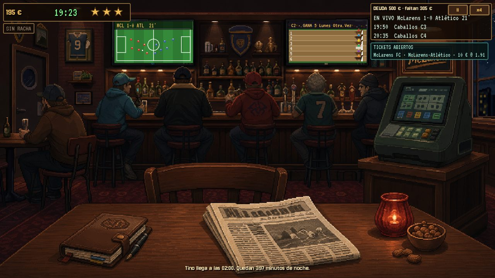

# MacLarens: La última combinada

Juego de apuestas y minijuegos en un bar de barrio, hecho en **Godot 4.7** con arte pixel 2.5D.
Le debes 1.800 € a Tino y te los cobra en cinco noches: 100, 150, 300, 500 y 750 € a las 02:00. Empiezas con 200 €.



## Cómo se juega

Una partida es **una campaña de 5 noches**, cada una de 18:00 a 02:00 (~13 minutos reales). El dinero, los niveles y los objetos pasan de una noche a la siguiente; si una noche no llegas a la cuota de Tino, se acaba. El bar tiene dos zonas, **la Barra** y **el Salón**:

| Dónde | Qué | Personaje |
|---|---|---|
| Barra · máquina | 2 partidos de fútbol (horarios distintos cada noche, 1X2 en directo con venta) y 10 carreras; boletos de hasta 50 € | El Búho (fútbol), El Cortado (caballos) |
| Barra · TV | El partido: medidor de presión y penalti | |
| Salón · TV | La carrera: arrear a tu caballo | |
| Salón · billar | "Tiro imposible" con guía de trayectoria: 3 mesas con misión, mete 2 y ganas (3 series por noche) | Tino (rival) |
| Salón · mesa | ¿Mayor o menor? con baraja española | El Chencho (rival) |
| Barra | Tienda: rondas para subir de nivel a la gente y objetos | Lucía |
| Periódico / libreta | Cartelera de la noche / tu gente, objetos y racha | |

Cada personaje tiene **3 niveles**; las mejoras y objetos **no regalan dinero**, dan herramientas que premian jugar bien. Diseño completo: [`docs/design/GDD.md`](docs/design/GDD.md).

## Jugar (versión 1.0, Windows)

Descomprime `McLarens_v1.0.zip` y abre `McLarens.exe`. Si Windows avisa, pulsa "Más información" y luego "Ejecutar de todas formas". Notas de la versión: [`docs/RELEASE_1.0.md`](docs/RELEASE_1.0.md).

## Arrancar desde el código

1. Instala [Godot 4.7](https://godotengine.org/download) (versión estándar, no .NET).
2. Abre `game/project.godot` y pulsa **F5**. Escena principal: `res://scenes/night.tscn`.

Controles: ratón; **P** pausa, **ESC** vuelve al bar, **ESPACIO** arrea/chuta; en el billar, ← → afinan la puntería.

## Pruebas

```bash
tools/run_tests.sh          # lógica (headless): noche, economía, campaña
tools/run_tests.sh todas    # + capturas de todas las pantallas, 2 noches completas, billar
```
En Windows: `.\tools\run_tests.ps1` o `.\tools\run_tests.ps1 -Todas` (define `$env:GODOT` si Godot no está en el PATH). Las capturas salen en `game/tests/output/`.

## Estructura

```
game/                 Proyecto Godot
  night/              Lógica de la noche (autoload Night, fútbol, caballos, catálogo)
  simulation/         Simulador de partidos por intervalos
  data/               Equipos y hechos de partido
  ui/                 Pantallas, minijuegos, widgets, HUD y kit de UI
  scenes/night.tscn   Escena principal
  tests/              Pruebas automáticas (escenas .tscn)
  assets/             Arte conceptual v1 y fuentes (OFL)
docs/
  design/GDD.md       Diseño vivo del juego
  ARCHITECTURE.md     Mapa del código y cómo extenderlo
  coordination/       Flujo de trabajo, tablero por hitos y decisiones
  reviews/            Reviews de Roi y playtests (no se editan)
  CODEX_ONBOARDING.md Arranque para Codex
  screenshots/        Capturas actuales
  source/ references/ archive/ art/   Material original e histórico
tools/                Scripts de pruebas; tools/dev: simuladores de equilibrio
```

## Cómo trabajamos

Roi dirige y prueba cada hito. **Claude** lleva los sistemas (reglas, economía, simulación, pruebas, documentación, billar) y **Codex** la presentación (pantallas, controles, audio, arte, exportar). Cada uno tiene su carpeta, se sincronizan por GitHub y se escriben en `CLAUDEHANDOFF.md` / `CODEXHANDOFF.md`. Reglas: [`docs/coordination/WORKFLOW.md`](docs/coordination/WORKFLOW.md); tareas: [`docs/coordination/TASK_BOARD.md`](docs/coordination/TASK_BOARD.md).

El código del prototipo de julio (slice de investigación con el caso Bruno Salas) está en la rama `archive/slice-julio`.

## Créditos

Fuentes [Jersey 10](https://fonts.google.com/specimen/Jersey+10) y [VT323](https://fonts.google.com/specimen/VT323), licencia SIL OFL 1.1 (`game/assets/fonts/`).
Juego de ficción. Ningún caballo fue sobornado.
